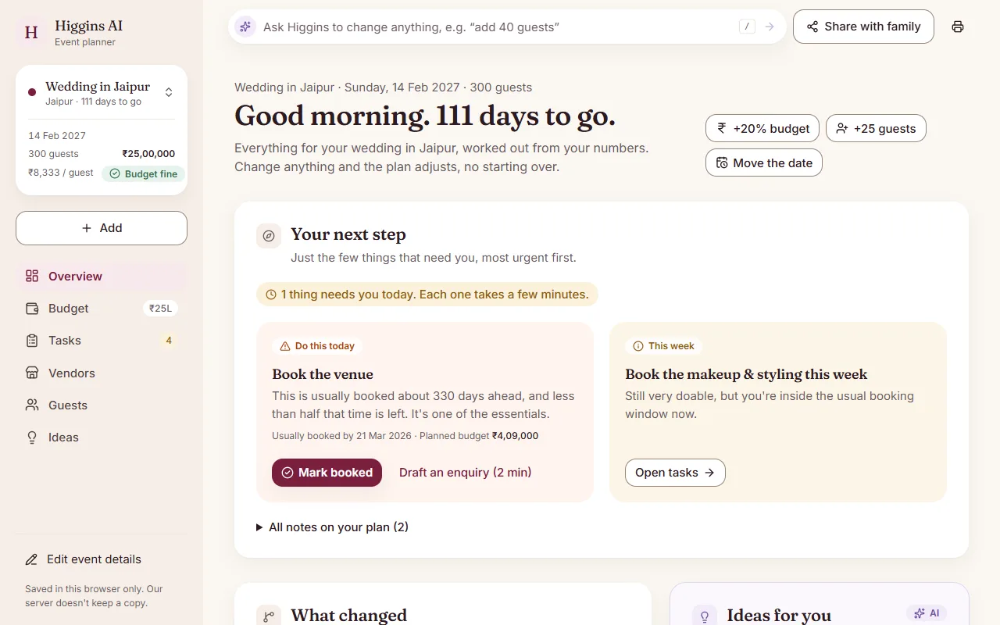

# Higgins AI: event planning assistant

A GenAI-powered planning assistant that helps people organise **weddings, birthdays and community events** with a budget split, a timeline worked backward from the date, a vendor checklist with "book by" dates, a triage mode for late planners, and personalised theme, décor and food ideas.



**Quick start** (Python 3.11+, Node 22; details in [Running it](#running-it)):

```bash
pip install -r requirements.txt
cd frontend && npm ci && npm run build && cd ..
uvicorn app.main:app        # open http://127.0.0.1:8000 and sign in with test / test
```

## Chosen vertical

**Event planning assistant** for the persona we call *the default organizer*.

Priya, 29, is a working professional in Bengaluru. She isn't a planner, but family, friends and her housing society keep handing her events: her cousin's wedding, her son's 5th birthday, the society's Diwali celebration. She has a date, a rough guest count and a fixed budget. She doesn't know how to price vendors or when to book them.

She opens the assistant at two moments:

1. **The event was just decided.** "Where do I start, and can this budget actually work?" She wants a realistic plan in minutes that she can share with family or the committee the same day.
2. **The event is 2–3 weeks away and she's behind.** "What's still possible, what do I cut, what do I book today?"

What she doesn't want is a chatbot she has to interrogate, or a tool that assumes she has a professional planner's knowledge. So the app is **one short form → one complete plan**.

## Approach and logic

The core design decision: **rules decide, AI personalises.**

| Part of the plan | Who decides | Why |
|---|---|---|
| Budget split, warnings, per-flat contribution | Rules engine | Numbers must be explainable, repeatable and never invented |
| Timeline, "book by" dates, triage | Rules engine | Dates come from lead-time arithmetic, not guesses |
| Themes, décor, food/menu, entertainment ideas | GenAI | Free-text taste ("pastel colours, my son loves dinosaurs") is what rules can't do well |
| Wording of triage advice | GenAI | Turns the rules' decisions into friendly advice, but cannot change them |

The engine (`app/engine/planner.py`) is a pure function, `build_plan(request, today)`. The same inputs on the same day always give the same plan, which is what makes share links and golden tests possible.

### Decision logic based on the user's context

1. **Base split per event type.** Each event type has its own category table (e.g. wedding: venue 20%, catering 30%, décor 12%, …).
2. **Venue type.** *At home* drops the venue line and gives its share to food and décor. *Outdoor* adds a 5% "tent & weather backup" line, plus a monsoon backup task if the date falls in June–September. *Venue includes catering* merges venue and catering into one line, as many Indian venues price per plate.
3. **Priorities (up to 3).** Each one gains +5 percentage points, taken proportionally from the non-priority categories. Contingency is never a donor, so it never drops below 5%.
4. **Rupees.** Lines are rounded down to ₹100. The leftover goes to contingency, so lines always add up exactly to the budget.
5. **Too-tight check.** Budget per guest is compared with a minimum per guest (metro: wedding ₹1,500, birthday ₹500, community ₹250), scaled by city size (metro ×1.0, tier-2 ×0.8, smaller town ×0.65). Below the floor, the plan warns and suggests cost-saving swaps.
6. **Budget level.** Budget per guest ÷ floor gives *tight* (< 1), *modest* (< 2), *comfortable* (< 4) or *generous* (≥ 4). This tells the AI how ambitious its ideas may be.
7. **Timeline.** Every vendor has an ideal lead time. Book-by date = event date − lead time. **Peak wedding season (Nov–Feb)** adds 60 days to the venue and photographer.
8. **Triage in three stages.** Each booking is **on track** (the full lead time is left), **tight but doable** (inside the lead time, but at least half of it left: "Book this week"), or **book today** (less than half left). Only "book today" items switch the plan into triage, so a wedding planned 5 months ahead reads as tight, not as an emergency. Essentials (venue, permissions, caterer) are flagged, never cut. Other "book today" items get a cheaper alternative (e.g. hired performers → resident talent).
9. **Community events.** If the number of households is given, the plan shows a per-flat contribution (budget ÷ households), which is how committees actually raise money.

## How the solution works

```
Browser (form, what-if sliders, localStorage, share links)
   │ 1. POST /api/plan  (milliseconds)        │ 2. POST /api/ideas  (seconds, in background)
   ▼                                          ▼
validate (Pydantic) → rules engine     validate → rules engine → cache hit?
(pure, today in Asia/Kolkata) → plan        → Groq (5 s) ─fails→ OpenAI (rest of 15 s) → Pydantic
                                              ↳ no key / both fail → ideas: null
```

The plan is on screen as soon as the rules engine returns. The ideas card shows a loading placeholder and fills in a few seconds later.

### AI providers and guardrails

Every AI call goes through one class, `StructuredAI` in `app/ai/client.py`, which tries a chain of providers within one time budget.

- **Groq first, OpenAI as the backup.** Groq (`openai/gpt-oss-20b` by default) usually answers in about a second. If it times out after 5 s, returns an error (429, 5xx, a bad key, a rejected schema) or sends JSON that fails the Pydantic check, OpenAI gets the rest of the 15 s budget. With less than 2 s left, the call gives up and the feature's non-AI path takes over.
- **The keys decide the chain.** Both keys: Groq, then OpenAI. One key: that provider alone. No key: AI is off, and the app still makes the full rules-based plan.
- **Each provider through its stable API.** OpenAI through its Responses API with `store=False`; Groq through Chat Completions, where strict JSON schemas are documented (its Responses API is in beta). Both use the official `openai` SDK; Groq only needs its `base_url`.
- **Rate limits respected.** After a 429, a provider rests for its `retry-after` time (at most 60 s), so a burst goes straight to the backup without first waiting for a refusal.
- **Per-task models in config.** `GROQ_MODEL_IDEAS`, `GROQ_MODEL_QUOTES` or `GROQ_MODEL_UNDERSTAND` swap the model for one task without touching code.
- **The AI reports, code computes.** Relative changes ("add 40 guests", "20% more budget") and dates counted from today ("tomorrow", "in 2 weeks", "next Saturday") are worked out in code, and each reading is shown ("I took 'in 2 weeks' as 4 Nov 2026"). Vague dates ("next week", "Feb 2027") are asked about, never guessed. So both providers give the same numbers and dates.
- **One log line per call:** task, provider, model, time taken and outcome (`ok`, `cached`, `timeout`, `429`, `auth`, `bad_request`, `invalid_json`). Never the prompt, the reply or a key.

#### Evals: why Groq goes first

`evals/` holds 38 fixed cases: 20 typed requests (new events, revisions, vague dates, small talk, a prompt injection), 12 pasted quotes (per-plate prices, "1.2 lakh", Hinglish, a non-quote, an injection) and 6 ideas requests (scored on rules: must-haves mentioned, no prices, nothing lavish on a tight budget, triage advice when needed). `python -m evals.run --provider groq` runs them through the app's real path with one provider and saves a table to `evals/results/`. They make real API calls, so they run by hand, never in pytest or CI.

Results on 30 Oct 2026 ([Groq](evals/results/2026-10-30-groq.md), [OpenAI](evals/results/2026-10-30-openai.md)):

| Task | Groq `gpt-oss-20b` | Typical time | OpenAI `gpt-5-nano` | Typical time |
|---|---:|---:|---:|---:|
| Typed requests | 19/20 | 1.2 s | 16/20 | 3.1 s |
| Quotes | 10/12 | 1.1 s | 9/12 | 3.4 s |
| Ideas | 6/6 | 1.6 s | 6/6 | 5.0 s |

- **Groq was as good or better on every task, at about a third of the time,** with no invalid JSON (OpenAI had one).
- **The evals caught a bug in our code.** For "change it to next Sunday", OpenAI also sent a 7-day move, which overrode the Sunday the code had worked out. A named day now wins over a relative move, with a test.
- **What's left for code checks:** Groq read "1.5L" as 15 lakh, multiplied "6 guards @ ₹900" despite being told not to, and took "+ 18% GST" as included. gpt-5-nano missed two quote categories and a year rollover.
- **Groq's free tier is tight:** at one call every 2.5 s, about half the eval calls hit its 8,000 tokens-a-minute limit. In the app those calls rest Groq and go to OpenAI, so they still work; a paid Groq tier would keep more of them fast.

### Routes

Every route validates its input with Pydantic, and every number comes from the rules engine. The three AI routes return `null` instead of an error when the AI fails, and the page always has a non-AI path.

| Route | AI | What it does |
|---|---|---|
| `POST /api/plan` | No | The rules-only `{plan, ai_available}`, in milliseconds |
| `POST /api/ideas` | Yes | Ideas for the same inputs, `{ideas, ai_available}`. If the call fails, `ideas` is null and the page offers "Try again" |
| `POST /api/compare` | No | The before/after of a change (what-if, money move, typed revision). Nothing is saved |
| `POST /api/messages` | No | A ready-to-send enquiry, follow-up or confirmation for one booking, filled from the plan. The budget is left out unless asked for |
| `POST /api/quotes/extract` | Yes | A pasted vendor quote read into a draft. It is marked AI-extracted and can't be accepted until the organiser checks it |
| `POST /api/understand` | Yes | Plain language ("wedding for 300 in Jaipur", "add 40 guests") into form values or a proposed revision with its before/after. The AI reports the change; the server does the maths |
| `GET /api/options` | No | Priority choices per event type, so the form never duplicates the rules |
| `GET /health` | No | Health check |

- **Backend:** Python + FastAPI, with the routes above. `ai_available` means at least one AI key is configured. The three AI routes are async, so a provider call waiting on the network doesn't hold a server thread.
- **AI layer (`app/ai/`):** the model gets the computed plan summary plus the organiser's preferences and must return JSON matching a strict schema. That JSON is then re-validated with Pydantic, including length limits. The plan's numbers are never taken from the AI. See [AI providers and guardrails](#ai-providers-and-guardrails).
- **Frontend (`frontend/`):** React 19, TypeScript, Vite, Tailwind and shadcn/ui. It is built to `frontend/dist` and served by FastAPI from the same origin, with no third-party scripts or CDNs.
- **No server-side accounts, no database.** Events, progress and guests are kept in the browser's `localStorage`. A demo sign-in (`test` / `test`, or make your own) keeps each account's events apart in that browser. It is not a secure login: anyone using the browser can read its storage. Passwords are kept only as a salted PBKDF2 hash.
- **Sharing:** the link holds the plan inputs in the query string and the AI ideas, compressed, in the `#fragment`. Browsers never send the fragment to the server. Free-text preferences are never put in the link. The query string does reach the server, like any URL, so it can appear in access logs; it holds only numbers, a date, a city and choices. Whoever opens the link sees the same budget and the same ideas, with the countdown and triage recalculated for *their* today. A "Plan created on …" note shows the original date.
- **What if…:** guest and budget sliders (¼× to 2× her own numbers) re-run the rules engine as she drags, with no AI call, so "what if we invite 150 instead of 200?" is answered instantly. Ideas made for the old numbers are marked as such, with a "Refresh ideas" button.
- **Print or save as PDF:** a one-page A4 summary for the family (key figures, what needs attention, budget, bookings, key dates, vendors, guests, ideas and notes), safe in black and white; a big event scales down to stay on one page.
- **Voice typing:** a mic on the longer text boxes (the plan box on the landing page and during setup, must-haves, taste and ideas, a pasted vendor quote, and Ask Higgins). It uses the browser's own speech recognition (Indian English), so there is no library; what is said is added after what is typed, ready to edit, and never sent by itself. Firefox has no speech recognition, so the mic is hidden there. Chrome and Edge send the audio to their maker's speech service to turn it into text; nothing reaches our server until the text is sent.
- **Rolling figures:** the Overview's four headline numbers roll in like an odometer, each digit a wheel, in two seconds: when the Overview opens, and from old to new digits when a figure changes. Plain CSS transforms, no library; with reduced motion they are simply shown, and screen readers get the plain number.

## Demo scenarios

These are real engine output with `today = 2026-10-21`. Each is also a golden test in `tests/test_engine.py`.

### 1. Happy path: cousin's wedding
Bengaluru (metro) · 250 guests · ₹15,00,000 · 12 Dec 2027 · venue includes catering · priorities: food, photography

**417 days to go · ₹6,000 per guest (floor ₹1,500) · budget OK · level: generous**

| Line | Amount | Share |
|---|---:|---:|
| Venue & catering *(priority, merged)* | ₹8,25,000 | 55.0% |
| Photo & video *(priority)* | ₹2,25,000 | 15.0% |
| Décor | ₹1,28,500 | 8.6% |
| Attire & styling | ₹1,07,100 | 7.1% |
| Music & entertainment | ₹53,500 | 3.6% |
| Invitations & gifts | ₹53,500 | 3.6% |
| Logistics | ₹32,100 | 2.1% |
| Contingency | ₹75,300 | 5.0% |

Book the venue by **16 Jan 2027** and the photographer by **15 Feb 2027**. December is peak season, so both moved 60 days earlier. Then décor and makeup (Aug 2027), outfits and music (Sep 2027), invitations (Oct 2027). No triage.

### 2. Tight budget: son's 5th birthday
Mysuru (tier-2, not in the metro list) · at home · 40 guests · ₹12,000 · 11 Nov 2026 · priorities: décor, activities

**21 days to go · ₹300 per guest · level: tight**

> ⚠ ₹300 per guest is below the ₹400 minimum we suggest for a birthday party in a tier-2 city. Try the cost-saving swaps, a shorter guest list or a bigger budget.

No venue line, because its 20% moved to food and décor: Food & cake ₹4,400 · Décor ₹3,600 (priority, 30%) · Entertainment & activities ₹2,000 (priority) · Return gifts ₹700 · Photography ₹400 · Contingency ₹900. The swaps include homemade snacks with a bakery cake, DIY décor and self-run games. The AI is told the budget level is *tight*, so its ideas stay low-cost.

### 3. Triage: society Diwali celebration
Bengaluru · outdoor · 500 attendees · 120 households · ₹1,50,000 · 8 Nov 2026

**18 days to go · ₹300 per guest (above the ₹250 floor) · per-flat contribution ₹1,250**

> ⚠ Your event is 18 days away. Less than half the usual lead time is left for 1 booking: book it today.
>
> ⚠ 4 bookings are inside the usual lead time but still doable: book them this week.

- **Book today:** venue (45-day lead time, only 18 days left)
- **Book this week:** permissions, performers, sound & lighting, caterer (21–30-day lead times, at least half left)
- **On track:** security & first aid, tent (by 25 Oct 2026)
- **Cut or swap:** none, because the venue is an essential and is never suggested as a cut. Nine days out, performers and sound would also be "book today", and the plan would suggest resident talent and a basic PA package instead.
- A "Tent & weather backup" line is added (outdoor). There's **no** monsoon task, because November is outside June–September.

## Running it

Requires Python 3.11+ and Node 22.

```bash
python -m venv venv
# Windows: venv\Scripts\activate    macOS/Linux: source venv/bin/activate
pip install -r requirements.txt
cp .env.example .env        # optional: add GROQ_API_KEY and/or OPENAI_API_KEY for the AI parts

cd frontend
npm ci
npm run build               # writes frontend/dist, which FastAPI serves
cd ..

uvicorn app.main:app
```

Open http://127.0.0.1:8000 and sign in with `test` / `test`, or create an account. Without the build step the API still runs, but there is no page to open. **No API key? It still works.** You get the full rules-based plan, and the ideas section says ideas are unavailable.

For frontend work, `npm run dev` in `frontend/` serves the page with hot reload and forwards `/api` to the uvicorn server on port 8000.

| Variable | Default | Purpose |
|---|---|---|
| `GROQ_API_KEY` | *(empty)* | Enables Groq, tried first. Server-side only, never sent to the browser |
| `OPENAI_API_KEY` | *(empty)* | Enables OpenAI, the backup (or the only provider without a Groq key). Server-side only |
| `GROQ_MODEL` | `openai/gpt-oss-20b` | A Groq model with strict JSON schema support |
| `GROQ_MODEL_IDEAS`, `_QUOTES`, `_UNDERSTAND` | *(empty)* | Optional model for one task |
| `GROQ_REASONING_EFFORT` | `low` | Keeps Groq's reasoning short |
| `GROQ_TIMEOUT_SECONDS` | `5` | Groq's share of the budget, so a slow reply leaves OpenAI time to answer |
| `OPENAI_MODEL` | `gpt-5-nano` | Cheapest current OpenAI model with Structured Outputs |
| `OPENAI_REASONING_EFFORT` | `minimal` | Keeps reasoning models fast. Leave empty for non-reasoning models |
| `AI_TIMEOUT_SECONDS` | `15` | The whole time one AI call may take, backup included. No retries on the same provider |
| `RATE_LIMIT_PER_MINUTE` | `20` | AI idea requests per IP per minute |
| `PLAN_RATE_LIMIT_PER_MINUTE` | `120` | Rules-only plan requests (including slider updates) per IP per minute |
| `AI_TOTAL_LIMIT_PER_HOUR` | `200` | AI requests per hour from all visitors together, a cap on spend |

## Deploying

Behind a hosting proxy (Render, Cloud Run, a load balancer), tell uvicorn to trust the proxy's `X-Forwarded-For` header. Otherwise every visitor shares the proxy's IP and the per-IP rate limit applies to everyone together:

```bash
uvicorn app.main:app --host 0.0.0.0 --port $PORT --proxy-headers --forwarded-allow-ips="*"
```

Only use `--forwarded-allow-ips="*"` when the app is reachable *only* through that proxy; otherwise list the proxy's IPs. The same flags let the app see that the visitor used HTTPS, which is when it sends `Strict-Transport-Security`. Set `GROQ_API_KEY` and `OPENAI_API_KEY` as platform secrets, not in a committed file, and give the OpenAI project a monthly usage limit as a second cap behind `AI_TOTAL_LIMIT_PER_HOUR`.

## Testing

```bash
pip install -r requirements-dev.txt
pytest                      # backend: 158 tests

cd frontend
npm test                    # frontend: 32 tests (Vitest)
npm run typecheck && npm run contrast
npm run build && npm run test:e2e   # end to end: 2 tests (Playwright, your installed Chrome)
```

Everything runs offline and free: both AI providers are faked (a guard blocks the real ones even with keys in `.env`), golden tests pin today to 21 Oct 2026, and the end-to-end run starts the server with empty API keys. GitHub Actions runs all of it on every push (`.github/workflows/ci.yml`).

**Backend (pytest, 158):**

- **`test_engine.py` (17):** the three golden scenarios, a wedding five months out that is "tight" but not in triage, cut suggestions that skip essentials, the monsoon rule, the contingency floor, an event tomorrow, past dates, invalid priorities, city tiers, Indian number formatting
- **`test_api.py` (28):** the plan over HTTP, plain-language 422 errors that don't echo input, 413/411 for oversized and chunked bodies, 429 rate limiting per endpoint and for all visitors' AI calls together (the AI limits never block plans), security headers (HSTS only over HTTPS), cache headers for built files, options, and `openapi.json` matching the API (with docs not served)
- **`test_understand.py` (35):** plain-language intake and revisions. The AI reports changes and the server does the maths: relative changes, dates counted from today ("tomorrow", "in 2 weeks", "next Saturday"), dates and cities only when named, missing fields, invalid revisions, no event-type changes
- **`test_routing.py` (9):** the provider chain. Groq answers first with a strict schema; OpenAI answers when Groq times out, is rate-limited, has a bad key or sends invalid JSON; a 429 makes Groq rest; a slow Groq hands over within the time budget; the log names the provider and outcome, never the prompt
- **`test_progress.py` (16):** booked and delayed tasks, dependencies, and how a delay ripples through the plan
- **`test_quotes.py` (16):** quote comparison, confirmed costs, and re-budgeting when a quote is accepted
- **`test_compare.py` (12):** money moves between budget lines and the before/after of two plans
- **`test_ai.py` (10):** ideas stay advisory. Bad JSON, extra fields, over-long text and timeouts give no ideas, never an error. Also: no API key, caching, preference fencing
- **`test_quote_extraction.py` (8):** a pasted quote becomes a checked draft or nothing, never an error; the quote text is fenced
- **`test_messages.py` (7):** vendor messages are filled from the plan, with no budget unless asked

**Frontend (Vitest, 32):** pure logic only, in the `node` environment. Tests sit next to their code as `*.test.ts`.

- **`features/overview/next-step.test.ts` (7):** what the Next step panel leads with: triage, then the soonest slip or due booking, then the next booking, then all clear
- **`lib/storage.test.ts` (6):** save/load per account, nothing kept while signed out, blocked or corrupt `localStorage` starts empty without crashing, events saved before accounts, v2 → v4 migration
- **`lib/format.test.ts` (6):** Indian grouping (₹1,50,000), lakh/crore short forms, the day turning over at midnight IST, day counts across months, the time-of-day greeting
- **`lib/share.test.ts` (5):** inputs survive the link; preferences, must-haves and progress never go in it; ideas survive the compressed `#fragment`; tampered ideas are dropped
- **`lib/accounts.test.ts` (3):** the demo sign-in, one message for a wrong password or an unknown username, usernames unique whatever their case
- **`features/print/sheet-data.test.ts` (3):** the printed sheet's booking order, its ten-booking cap, and key dates kept when milestones are trimmed
- **`lib/csp.test.ts` (1):** the CSP's hash for Radix Select's `<style>` still matches the installed Radix
- **`lib/use-speech.test.ts` (1):** spoken text is added after what's typed, never in its place, within the field's limit

**End to end (Playwright, 2):** `e2e/plan.spec.ts` runs the built app on the real backend with AI off. The landing page loads, and a shared plan opens in the dashboard after signing in with the demo account.

## API types

The frontend's API types are generated from the backend's Pydantic models, so the two can't drift apart. After changing `app/models.py` or `app/responses.py`:

```bash
python scripts/export_openapi.py        # from the repo root: writes frontend/openapi.json
cd frontend && npm run gen:types        # writes src/lib/api-types.ts
```

Both files are committed, so the frontend builds without Python. `src/lib/types.ts` re-exports them under friendly names (`Plan`, `PlanRequest`, …) and holds the few types the API doesn't describe: guests and `/api/options`. A backend test fails if `openapi.json` is out of date.

- **Response types are complete.** API models extend `ApiModel`, which marks fields with defaults as required in output schemas, because responses always include them. A model used both ways gets an `-Input` and an `-Output` schema; the app works with `-Output`.
- **`gen:types` runs through `npx`,** pinned to `openapi-typescript@7.13.0` with TypeScript 5.9. `openapi-typescript` needs TypeScript's JS compiler API, which TypeScript 7 (this project's compiler) doesn't ship, so it can't be a devDependency here.
- The schema is only exported, never served: `/openapi.json` and `/docs` stay disabled.

## Security

- The Groq and OpenAI keys live only in the server's `.env` (git-ignored). The browser never calls an AI provider.
- **What reaches an AI provider:** the plan summary and what the organiser types or pastes (preferences, must-haves, quotes, Ask Higgins messages) go to Groq, and to OpenAI when it answers as the backup. Never guest lists, accounts or progress. OpenAI calls use `store=False`. Groq offers Zero Data Retention in its Data Controls settings; turn it on for a deployment.
- Strict input validation: typed fields, ranges, length limits, a city-name character check, unknown fields rejected, and a 64 KB request cap (a plan carries the progress kept in the browser: bookings and up to 20 quotes). API requests must declare `Content-Length`, so a chunked body can't bypass the cap. Validation errors are returned in plain language ("Please enter the event date.").
- **Prompt injection:** everything the organiser types or pastes (preferences, must-haves, vendor quotes, Ask Higgins messages) is treated as untrusted data. Markup characters are stripped, the text is fenced in tags such as `<preferences>` or `<quote>`, and the model is told to ignore any instructions inside. Output must pass a strict schema and Pydantic validation. The plan's numbers never come from the AI.
- Everything (AI output, shared links) is rendered as text by React, never as HTML: there is no `dangerouslySetInnerHTML` anywhere. Shared ideas are checked for shape and size before display.
- Security headers on every response: strict `Content-Security-Policy`: same-origin scripts and styles only, never `'unsafe-inline'`. The landing page's machine links its stylesheet and sets the rest from script. Radix's scroll lock would inject a `<style>`, so `react-style-singleton` is aliased to `src/lib/style-singleton.ts`, which adopts a constructed stylesheet instead. Radix Select's one fixed `<style>` is allowed by its hash, and a test fails if Radix changes it. Checked in headless Chrome: no CSP violations on the landing page or across the app, in light and dark, `X-Content-Type-Options`, `X-Frame-Options: DENY`, `Referrer-Policy: no-referrer` (plan inputs in the URL never leak to other sites), `Permissions-Policy` (no camera or location; the microphone only for our own pages, for voice typing), `Cross-Origin-Opener-Policy: same-origin`, and `Strict-Transport-Security` whenever the page was reached over HTTPS.
- Per-IP rate limiting, strict for the AI endpoints and looser for the cheap rules endpoints (behind a proxy, see [Deploying](#deploying)). A second limit caps AI calls from all visitors together per hour, so requests from many IPs can't run up the bill. Errors never expose stack traces or submitted values. Logs record one line per AI call (task, provider, model, time, outcome), never prompts, replies or keys.
- No personal data is stored on the server.
- **Sign-in is a demo, not a security boundary.** Accounts live in the browser, so they keep events apart but don't protect them from someone using the same browser. Real accounts would need a server and a database (see [Future improvements](#future-improvements)).

## Efficiency

- The rules engine runs in microseconds, so the plan appears immediately and the what-if sliders can re-run it freely (debounced, outdated responses discarded). Only the ideas need an AI call: one per plan, in the background. Groq answers first because it's fast; a failed provider hands over to the next instead of retrying.
- An in-memory LRU cache (1 hour) means a repeated plan doesn't repeat the AI call. A shared link restores ideas from the URL instead of calling the AI again.
- The cheapest suitable model, minimal reasoning effort and capped output tokens.
- Every response over 1 KB is gzipped. Hashed build files are cached for a year and the page revalidates on every visit, so a deploy shows up at once.
- Each page is its own chunk: a first visit to the landing page downloads about 113 KB of gzipped JavaScript, not the dashboard. No external requests: fonts and scripts are self-hosted.

## Accessibility

- Every input has a `<label>`; radio and checkbox groups use `<fieldset>`/`<legend>`.
- Fully keyboard-operable, with a visible focus ring and a skip link.
- Results are announced through an `aria-live` status region, and focus moves to the plan heading.
- Field errors are linked with `aria-describedby` and `aria-invalid`, and focus moves to the first invalid field.
- Focus never drops to the page: dialogs return it to what opened them (or the menu's button, or the next sensible control). Toasts announce the Ctrl+Z undo shortcut, so undo is reachable before they leave.
- Colors meet WCAG AA contrast in both light and dark mode. Status never relies on color alone ("Book today", "(overdue)", "priority" tags). Touch targets are at least 44 px, apart from the compact Light/Dark toggle in the sidebar (28 px) and the mic inside text boxes on wider screens (36 px), both above the 24 px minimum. The layout is phone-first.

## Lighthouse

Lighthouse 13.5.0 on the production build served by uvicorn (with its CSP), headless Chrome, median of 3 runs, 28 Oct 2026. Mobile is Lighthouse's default throttled phone (412 px wide, so the landing page shows the poster); desktop shows the live machine. The dashboard is opened from a share link.

| Page | Device | Performance | Accessibility | Best Practices | SEO |
|---|---|---|---|---|---|
| Landing | Desktop | 98 | 100 | 100 | 100 |
| Landing | Mobile | 85 | 100 | 100 | 100 |
| Dashboard | Desktop | 99 | 100 | 100 | 100 |
| Dashboard | Mobile | 78 | 100 | 100 | 100 |

Mobile performance varies by about ten points between runs. What remains there is mostly React's first render on a slow phone.

## Assumptions

- **Heuristics are planning guidance, not market quotes.** All of them are named constants with comments in `app/engine/rules.py`.
- **Wedding numbers were checked** against Indian sources (Oct 2026):
  - The planner-guide ranges for wedding budgets are venue 20–28%, catering 18–25%, décor 10–16% and photography 7–10% ([Samaro](https://samaro.ai/blogs/how-to-plan-a-wedding-budget-india-2025), [Panache](https://panachehautecouture.com/blogs/indian-weddings/ultimate-guide-to-budget-planning-for-an-indian-wedding-costs-savings-tips)).
  - Bengaluru caterers list starting prices of about ₹200–500 per plate for veg and ₹300–650 for non-veg ([WedMeGood listings](https://www.wedmegood.com/profile/Kiran-Catering-Services-1979248)). That makes ₹1,500 per guest, with ₹450 per plate at 30%, a sensible floor.
  - Planning guides suggest booking the venue 10–12 months ahead, the photographer about 10 months and the caterer 6–10 months ([Junebug](https://junebugweddings.com/vendors/india/), [The Knot](https://www.theknot.com/content/indian-brides-wedding-planning)).
- **Birthday and community numbers are unverified assumptions.** No reliable published data was found. Only the constants would need to change.
- **City size:** a small built-in metro list. Other cities default to tier-2, and the form lets the user override this.
- **"Today" is India time** (Asia/Kolkata), so a plan made late at night doesn't shift by a day.
- **Single process:** the rate limiter and cache are in memory. Running several server instances would need a shared store such as Redis.
- **Shared plans are live:** they recalculate the countdown on the day they're opened.
- Amounts are whole rupees. Budget ₹1,000 to ₹10 crore, 1–5,000 guests, events up to 3 years ahead.

## Future improvements

- Server-side accounts, so plans follow the organiser across devices and can be shared for editing
- Live deployment (Render / Cloud Run) with a shared rate-limit store
- Regional cost data per city and vendor category, and verified benchmarks for birthdays and community events
- Expense tracking against the plan
- Vendor contact lists and WhatsApp reminders for book-by dates

## Project structure

```
app/                       FastAPI + Pydantic v2
  main.py                  App, routes, error handlers, security middleware
  models.py                Request and plan schemas, input validation (ApiModel base)
  responses.py             Response bodies for the routes
  services/understand.py   /api/understand: typed request → form values or a revision with its before/after
  validation_messages.py   Pydantic validation errors in plain language
  config.py, security.py   Settings from .env; rate limiter and security headers
  engine/                  Deterministic rules, no AI
    rules.py               All planning heuristics as named, commented constants
    planner.py             build_plan(request, today): same inputs, same plan
    progress.py, moves.py, quotes.py   Bookings and delays, money moves, vendor quotes
    diff.py, messages.py   Before/after of two plans; ready-to-send vendor messages
    message_checks.py      Keeps only what a typed message actually says (dates, city, priorities, +/−)
  ai/                      Every AI call (Groq, then OpenAI), all optional
    client.py              The one place that talks to providers: the chain, time budget, rests, log
    ideas.py, quotes.py, understand.py   Ideas, quote extraction, plain-language intake (prompt + caller)
    prompt.py, untrusted.py, schema.py   Prompts, fencing of typed text, strict output schemas
evals/                     Manual evals: cases/*.jsonl, run.py, results/ (real API calls, never in CI)
scripts/export_openapi.py  Writes frontend/openapi.json for the generated types
tests/                     pytest suite (offline, AI faked)
.github/workflows/ci.yml   Backend tests, frontend typecheck, tests, contrast and build, then end to end

frontend/                  React 19 + TypeScript + Vite + Tailwind + shadcn/ui
  openapi.json             The API schema, exported from FastAPI
  how-it-works/            Source of the landing page's machine (a framework-free web component):
                           src/, vendored kit/, build.mjs. npm run build:hm writes public/hm/;
                           the posters are committed (see how-it-works/README.md)
  public/hm/               Built machine: loader.js, machine.js, machine.css, poster.html, PNGs
  src/
    main.tsx, App.tsx      Entry and page routing; each page is a lazy-loaded chunk
    pages/                 onboarding.tsx and dashboard.tsx (the shell and every section, one chunk)
    state/
      auth.tsx             Who is signed in; the planner is mounted once per account
      nav.tsx              Open event and section, kept in the URL hash
      planner/             App state: store (state, request tickets), events, ideas,
                           plan-actions, persistence; index.tsx composes them
    features/<domain>/     overview, budget, tasks, vendors, guests, ideas, shell, landing, auth,
                           print, onboarding (questionnaire container, steps/, pure form.ts).
                           A feature never imports another; only App.tsx and pages/ import features
    components/            State-free building blocks: badges, layout (Panel, Stat, EmptyState),
                           field-error, page-band, error-boundary (a crash shows a reload, not a blank page)
      app/                 Shared pieces that read planner state or call the API: dialogs
                           (booking, change, message), toaster, rebalance note, ideas status
      ui/                  shadcn primitives
    lib/
      api.ts               Typed fetch wrappers
      api-types.ts         Generated by npm run gen:types (don't edit)
      types.ts             Friendly names for the generated types, plus browser-only ones
      format.ts, share.ts, storage.ts, tasks.ts   Formatting, share links, localStorage, task badges
      guests.ts            Guest-list helpers (expected head count)
      accounts.ts          Demo accounts in this browser (salted PBKDF2 hashes)
      use-speech.ts        Voice typing through the browser's speech recognition
      style-singleton.ts   CSP-safe stand-in for react-style-singleton (Radix scroll lock)
    **/*.test.ts           Vitest, next to the code it covers
  e2e/, playwright.config.ts   End-to-end test of the built app on the real backend, AI off
  scripts/contrast.mjs     WCAG AA contrast check for every colour pair
```

## License

[MIT](LICENSE)
